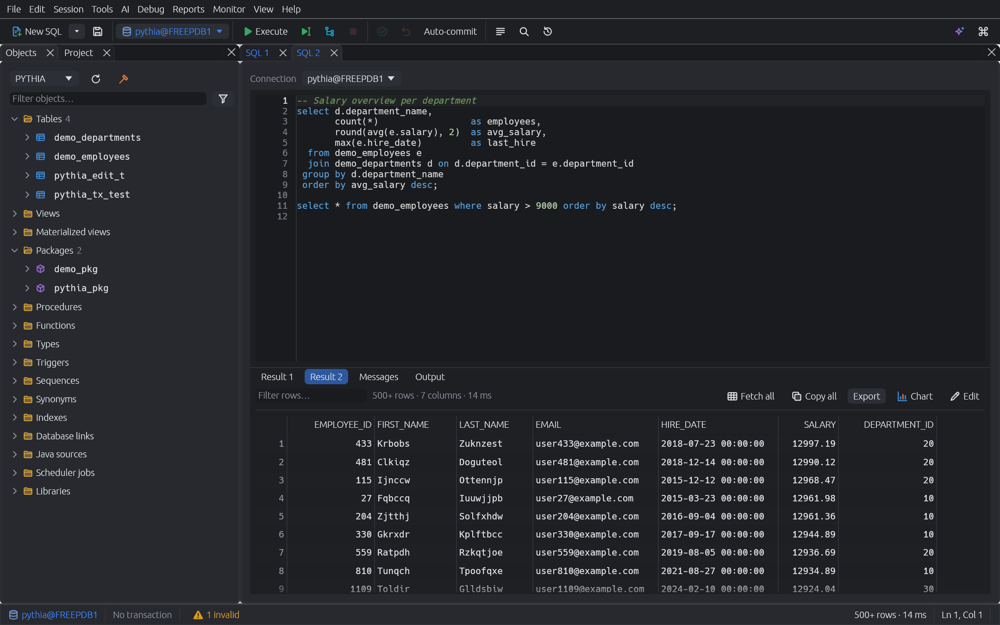
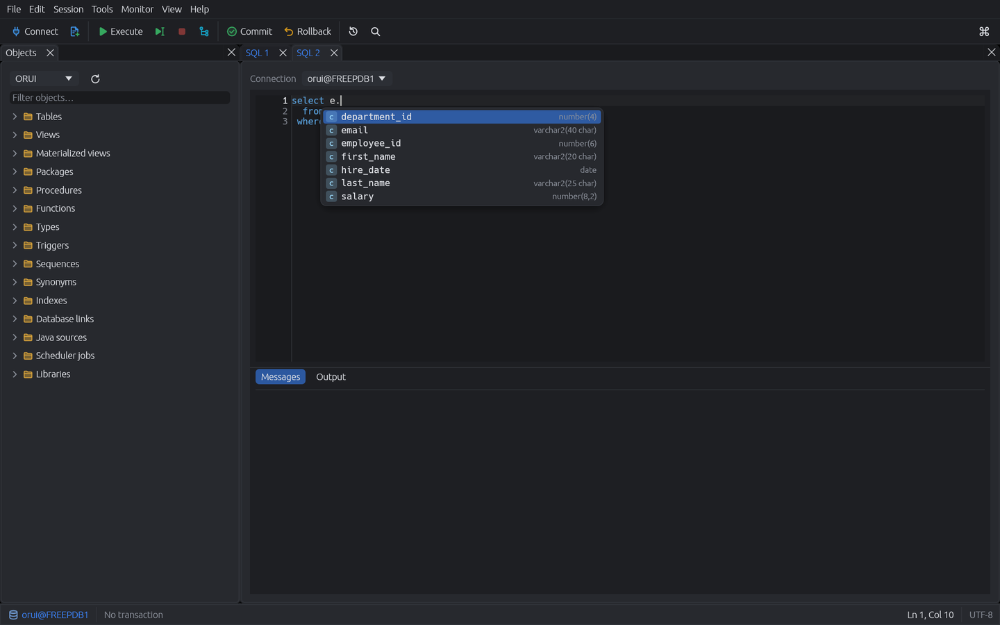
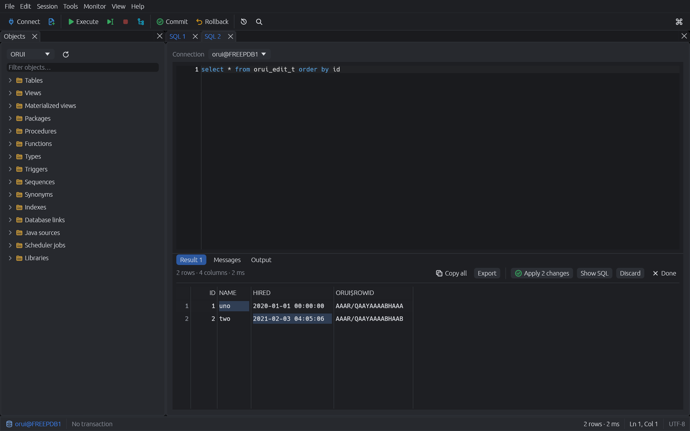
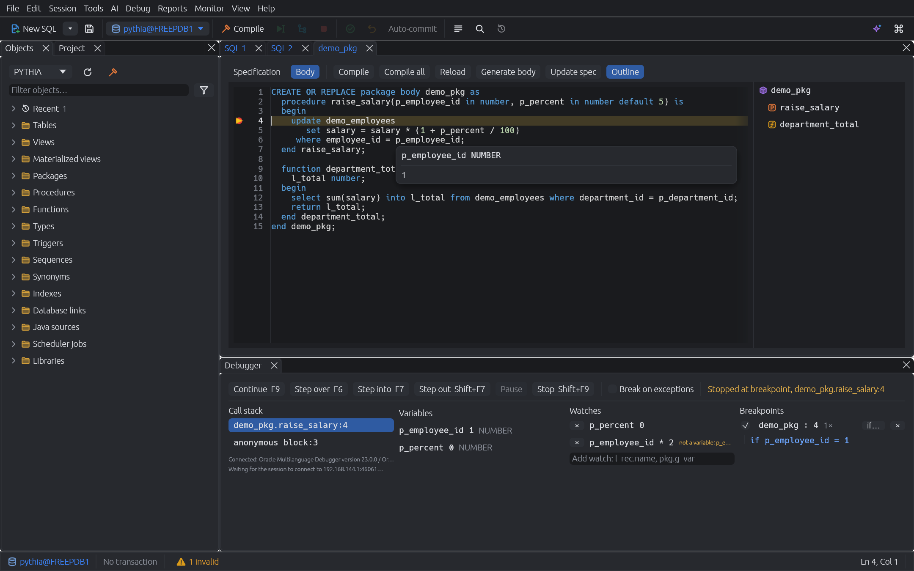
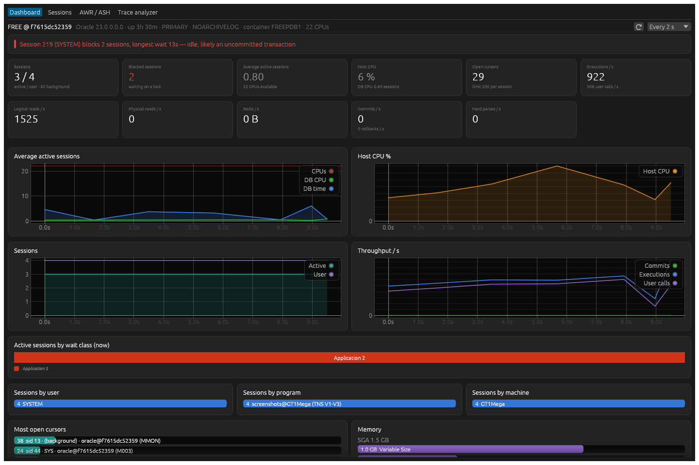
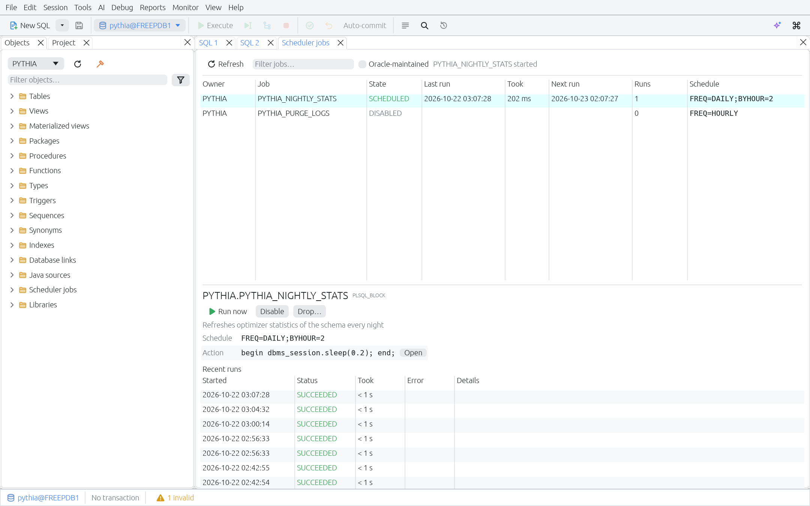
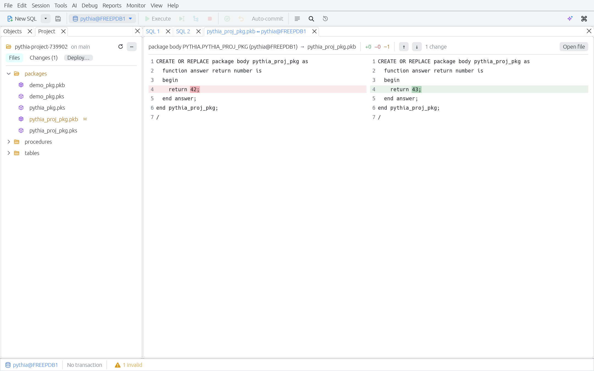

# Pythia

A fast, native Oracle PL/SQL IDE written in Rust (egui on wgpu). It covers the
daily work of an Oracle developer — writing and running SQL, editing and
compiling PL/SQL, debugging, browsing, editing data, comparing schemas and
watching what the database is doing — in one responsive, keyboard-first app
for Linux, Windows and macOS.



## Features

**Editor**
- Rope-backed code editor built for large packages: syntax highlighting,
  multi-cursor, block selection, find/replace with regex, bracket and
  `BEGIN`/`END` matching, comment toggling, case conversion, line moves.
- Context-aware completion: columns after `alias.` (joins, CTEs, inline
  views), package members with signatures, `%ROWTYPE` and cursor records,
  locals and parameters, schema objects and public synonyms.
- Signature help, hover, Ctrl+click / F12 go to definition (also into the
  database), references, live syntax diagnostics and an outline.
- Rename a local variable, parameter, alias or CTE in place (Shift+F6).
- Code folding, numbered bookmarks (Ctrl+Shift+1..9 / Ctrl+1..9) and
  snippets with placeholders (type a trigger, press Tab).



**SQL windows**
- Run the statement under the cursor (Ctrl+Enter), the selection or the
  whole script (F8); SQL\*Plus `exec`, `prompt`, `define`, `desc`, `&vars`.
- Bind and substitution variables are prompted and remembered.
- Results in a virtualized grid: sorting, rectangular selection, aggregates,
  record view, value viewer, copy and export (CSV, TSV, JSON, Excel,
  INSERT statements, Markdown, HTML).
- **Follow foreign keys**: right-click a row to open its parent row or its
  child rows in any table referencing it.
- **Chart any result** as bars or lines: the x axis defaults to the first text
  or date column, numeric columns become series; the chart follows the grid's
  filter and sort.
- **Edit results in place** — no `FOR UPDATE` locks: changes are checked
  against the fetched values when applied, so concurrent modifications are
  reported instead of overwritten. "Show SQL" previews the DML.
- **Execute to file** streams a query of any size into CSV, TSV, JSON,
  INSERT statements or Markdown, with live row count and cancel.
- Explain plan (F5), DBMS_OUTPUT, statement history (Ctrl+E).



**PL/SQL development**
- Object browser with lazy, virtualized folders, invalid markers, compile,
  drop, describe, query, test; favorites and recently opened objects;
  filters for invalid or recently changed objects; tables expand to
  columns, indexes, constraints, triggers and referencing tables.
- Form editors for sequences, views, synonyms, indexes and grants, with a
  preview of the generated DDL.
- Program windows with spec and body, compile with clickable errors
  (gutter markers and squiggles), unsaved-change tracking, save to file.
- **Test…** generates a ready-to-run block for any procedure or function
  (IN parameters as binds, OUT parameters printed).
- **Debugger** (DBMS_DEBUG_JDWP): breakpoints with conditions and hit
  counts, break on exception, step over/into/out (also through the debugged
  block itself), call stack with subprograms, variables of any frame
  including records, `%ROWTYPE` and collections, watches, values on hover.
  Units with breakpoints are compiled with debug information; Step into
  enters only units that have it (program windows can compile with it,
  Settings → Debugger, and the panel says when a step went over a unit
  without).
- **Profiler** (DBMS_HPROF): profile a block or call and see self and
  total time per subprogram and SQL statement; double-click jumps to the
  code. Needs `EXECUTE` on `DBMS_HPROF`; profiling commits.
- Find in database source (Ctrl+Alt+F) with regular expressions.
- **Formatter** (Ctrl+Shift+F) with a live preview of its rules, profiles
  to share a team style, rules learned from existing code (an editor or a
  whole schema), formatting on save, on paste or when a statement's `;` is
  typed, and the AI for statements the rules can't lay out (only
  whitespace and case may change).



**Monitoring**
- Dashboard with plain-language findings ("session 175 blocks 2 sessions —
  likely an uncommitted transaction"), KPIs and live charts.
- Sessions with a hierarchical blocking tree, session details, kill/cancel.
- AWR / ASH reports (only when the Diagnostics Pack is enabled) and a
  built-in tkprof-style trace analyzer.



**AI assistant**
- Bring your own model: the Anthropic API, any OpenAI-compatible API, a
  local model server (Ollama, llama.cpp, LM Studio) or a command line tool
  (prompt on stdin, answer on stdout). Several can be set up, one is the
  default; API keys live in the OS keychain.
- Generate SQL from a description, using the real tables, columns and
  foreign keys of the connected schema; explain, fix (with the compile or
  run errors) or rewrite the statement under the cursor or the selection,
  then replace it or insert the answer's code with one click.
- Plain-language plan analysis (EXPLAIN PLAN, or the actual plan of a run
  with statistics) with likely problems and concrete fixes; "Analyze with
  AI" on top SQL, session details, AWR/ASH reports and traces.
- A side panel for open-ended questions about the focused window. Table
  definitions, statistics, plans and source go with requests; result rows
  and bind values only if you allow it in Settings → AI, and each answer
  shows what was sent.

**Data and schema tools**
- Schema compare with structural table diffs and safe, ordered sync
  scripts; data compare by key with sync DML.
- Export tables: pick tables, a WHERE per table, CSV/TSV/JSON/INSERT/
  Markdown, one file per table plus DDL, streamed with progress.
- Import CSV/Excel: drop a file, check inferred types (decimal commas,
  date formats), import into a new or existing table with array DML.
  Per column: trim, date format, SQL expression (`upper(:value)`,
  constants); bad rows can be skipped and logged to `<file>.bad.csv`.

**Reports**
- Built-in reports (invalid objects, unindexed foreign keys, largest
  segments, top SQL, locks, jobs, …) open as editable queries.
- Save any query as your own report; bind and substitution variables are
  asked for when it runs.

**Scheduler jobs**
- All DBMS_SCHEDULER jobs with state, schedule, last and next run; run now,
  stop, enable, disable, drop; recent runs with errors.



**Projects and version control**
- Open a folder of SQL and PL/SQL files as a project: git status in the
  tree, a list of changed files, diff with the last commit.
- Compare a file with its object in the database, side by side.
- Export a schema as one file per object (`tables/`, `packages/*.pks|pkb`,
  …) to put it under version control.
- Deploy changed files: a reviewed script of `@file` lines in dependency
  order.



**Safety**
- Every window has its own session and transaction (multi-session); the
  status bar always shows pending transactions; production connections are
  marked red and ask before commit; read-only connections; passwords live
  in the OS keychain.

**MySQL (experimental)**
- Connect to MySQL (tested with 9.4; MariaDB not yet) with *Type: MySQL* and `host:3306/database`
  (`?tls` for TLS, `?tls=skip-verify` for self-signed certificates); no
  client library needed.
- SQL windows with results, fetching on demand, Break, explain plan,
  completion with columns and comments, and transactions that work as with
  Oracle: queries see what others committed, changes wait for Commit.
  Warnings show as messages.
- The object browser lists tables, views, procedures, functions and
  triggers; object views show columns, indexes, constraints, triggers,
  grants, dependencies and the DDL. *Edit* opens a routine as a script that
  drops and creates it again.
- Everything built on Oracle's dictionary or PL/SQL — debugger, profiler,
  monitor, reports, scheduler jobs, compare, import/export, editing results,
  the form editors — isn't offered on MySQL connections. As in SQL\*Plus,
  end a routine with `/` on a line of its own (there is no `DELIMITER`).

## Installing

Packages for Linux (`.deb`, AppImage), Windows (MSI, setup `.exe`) and
macOS (`.dmg`) are attached to each [GitHub
release](https://github.com/ortic/pythia/releases).

Pythia talks to Oracle through the **Oracle Instant Client**, which Oracle's
license doesn't allow us to bundle. Install it once:

1. Download *Basic* for your platform from
   <https://www.oracle.com/database/technologies/instant-client/downloads.html>.
   *Basic Light* works too, but it only has the small time zone file:
   `TIMESTAMP WITH TIME ZONE` values with region names (e.g. scheduler job
   times) then fail with ORA-01805.
2. Unpack it, e.g. to `/opt/oracle/instantclient_23` or `C:\oracle\instantclient_23`.
3. Make it findable:
   - **Linux:** `sudo apt install libaio1t64` (or `libaio1` on older
     distributions), then either set `LD_LIBRARY_PATH=/opt/oracle/instantclient_23`
     or register it once with
     `echo /opt/oracle/instantclient_23 | sudo tee /etc/ld.so.conf.d/oracle.conf && sudo ldconfig`.
   - **Windows:** add the directory to `PATH` (System Properties → Environment
     Variables) and install the Visual C++ redistributable it lists.
   - **macOS:** run `install_ic.sh` from the DMG (it copies the client to
     `Downloads`), then link the library where Pythia finds it:
     `mkdir -p ~/lib && ln -s ~/Downloads/instantclient_23_*/libclntsh.dylib ~/lib/`.
4. Optional: put your `tnsnames.ora` into `network/admin` inside the Instant
   Client directory or point `TNS_ADMIN` at it; Pythia then offers the aliases
   when connecting.

**Database versions:** Pythia is developed against Oracle 23ai and also
tested against 11.2 XE, 18c XE and 21c XE. A few features need a newer
release: the profiler, *Cancel current SQL* in the monitor and restarting a
sequence need 18c; reading trace files through the database needs 12.2.
Instant Client 23 connected to all of these in our tests, but Oracle
supports it only for Database 19c and later. For older databases use
Instant Client 19 (11.2 and later) or 21 (12.1 and later).

Proxy authentication works with the usual `proxy_user[target_user]` user
name; an empty user name with a wallet or OS authentication connects as
`/@alias`.

If the client can't be loaded, Pythia says so when you connect and shows these
steps.

## Building from source

Requirements: Rust (stable) and the Instant Client as above.

```sh
cargo build --release
LD_LIBRARY_PATH=/path/to/instantclient ./target/release/pythia
```

Packages are built with [cargo-packager](https://github.com/crabnebula-dev/cargo-packager)
(`cargo install cargo-packager --locked`):

```sh
cargo packager --release -p pythia-app            # all formats of this platform
cargo packager --release -p pythia-app -f deb     # just one
```

The output lands in `target/packages`. Releases are built by
`.github/workflows/release.yml` when a `v*` tag is pushed.

## Development

A local Oracle Free database for development and tests:

```sh
docker compose up -d        # or: podman compose up -d
```

Tests that need the database are skipped unless configured:

```sh
export LD_LIBRARY_PATH=/path/to/instantclient
PYTHIA_TEST_DB=pythia/pythia@localhost:1521/FREEPDB1 cargo test
```

| Variable | Used by |
|---|---|
| `PYTHIA_TEST_DB` | integration tests (app user) |
| `PYTHIA_TEST_MYSQL` | MySQL tests, e.g. `pythia/pythia@localhost:3306/pythia` for `docker compose up -d mysql` |
| `PYTHIA_TEST_DB_DBA` | monitor, compare and debugger tests (`system/oracle@…`) |
| `PYTHIA_DEBUG_HOST` | debugger tests: how the database reaches this machine (`host.containers.internal` for a local Podman container; with Docker on Linux, the compose network's gateway from `docker network inspect pythia_default`) |
| `PYTHIA_SCREENSHOT_DIR` | renders the real UI offscreen into PNGs (`cargo test -p pythia-app screenshots`) |

The debugger needs `DEBUG CONNECT SESSION`, `DEBUG ANY PROCEDURE` and a JDWP
network ACL; `pythia_debugger::target::setup_script` prints what a DBA has to
run. `crates/pythia-debugger/tests/scenario.rs` steps through a larger
scenario (packages, records, collections, an object type, a trigger).

Several app tests use the demo schema that the screenshot test creates, so
on a fresh database run `cargo test -p pythia-app screenshots::screenshots`
once with `PYTHIA_SCREENSHOT_DIR` set. The reports test needs
`SELECT_CATALOG_ROLE` for the test user.

### Workspace

| Crate | Purpose |
|---|---|
| `pythia-app` | the application: documents, docking, commands, dialogs |
| `pythia-ui` | code editor, data grid, icon set |
| `pythia-db` | sessions on worker threads (Oracle, MySQL), dictionary queries, what each database supports (`Dialect`, `Feature`) |
| `pythia-plsql` | lexer, statement splitter, error-tolerant parser |
| `pythia-lsp-core` | completion, hover, navigation, outline, diagnostics |
| `pythia-data` | export and import |
| `pythia-debugger` | JDWP debugger and panel |
| `pythia-monitor` | dashboard, sessions, AWR/ASH, trace analyzer |
| `pythia-compare` | schema and data compare |
| `pythia-ai` | AI backends (HTTP, command line), prompts and the data policy |
| `pythia-config` | settings and saved connections |

See [CONCEPT.md](CONCEPT.md) for the full plan and status.

## Keyboard

| Key | Action |
|---|---|
| Ctrl+Enter / F8 | Execute statement / selection or script |
| F5 | Explain plan |
| Shift+Esc | Cancel running statement |
| F10 / Shift+F10 | Commit / rollback |
| Ctrl+Space | Completion |
| F12, Ctrl+click | Go to definition |
| Ctrl+E | Statement history |
| Ctrl+Shift+O | Find database object |
| Ctrl+Alt+F | Find in database source |
| Ctrl+Shift+P | Command palette |
| Ctrl+F9 | Debug block under cursor |
| Ctrl+B | Toggle breakpoint |
| F9 / F6 / F7 / Shift+F7 / Shift+F9 | Continue / step over / into / out / stop |
| Ctrl+O / Ctrl+S | Open / save file |
| Shift+F6 | Rename symbol |
| Ctrl+Shift+[ / ] | Fold / unfold |
| Ctrl+Shift+1..9, Ctrl+1..9 | Set / jump to bookmark |
| Ctrl+, | Settings |

All application shortcuts can be changed in Settings → Keyboard.
